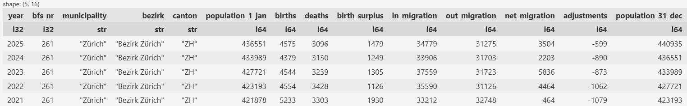

# Swiss Municipalities with Population over Years

This project prepares the dataset **Bilanz der ständigen Wohnbevölkerung nach Bezirken und Gemeinden, 1991-2025** published by the Swiss Federal Statistical Office (BFS) [here](https://www.bfs.admin.ch/bfs/rm/home.assetdetail.36681837.html). 

The notebook [`municipality.ipynb`](municipality.ipynb) downloads the Excel file, loads its sheets into a flat polars table, prepares it, and stores it as Parquet or Excel.

## Getting started

Create a Python 3.13 environment and install the notebook dependencies with [uv](https://docs.astral.sh/uv/):

```powershell
uv venv --python 3.13
uv pip install --python .venv\Scripts\python.exe fastexcel jupyter polars requests xlsxwriter
```

Open the notebook, e.g., in VS Code and select `.venv` as its kernel.

## Result

The result is a flat table with columns

- year (2011 to 2025)
- bfs_nr
- municipality
- bezirk
- canton (BE, ZH, ...)
- and population related columns

### Example of the result (Zürich)


